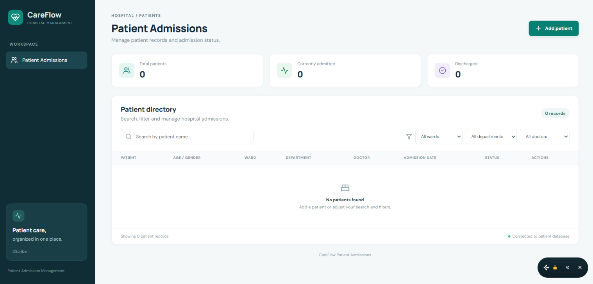

# CareFlow – Patient Admission Management App

A responsive Patient Admission Management application developed as part of the **DScribe Software Engineer Intern – Round 1 Assignment**.

The application helps manage patient admission records, including adding, viewing, editing, searching, filtering, and discharging patients.

## Live Application

- **Frontend:** https://idyllic-cannoli-6c802f.netlify.app/
- **Backend API:** https://dscribe-patient-api-ez8l.onrender.com
- **API Documentation:** https://dscribe-patient-api-ez8l.onrender.com/docs
- **GitHub Repository:** https://github.com/Sushma2110/patient-admission-webapp

## Technology Stack

| Component | Technology |
|---|---|
| Frontend | React.js, Vite |
| Backend | Python, FastAPI |
| Database | PostgreSQL (production), SQLite (local development) |
| ORM | SQLAlchemy |
| Validation | Pydantic |
| Frontend Hosting | Netlify |
| Backend Hosting | Render |

## Features

- Add new patient admission records.
- View all registered patients.
- Edit existing patient details.
- Delete patient records with confirmation.
- Mark patients as discharged.
- Search patients by name.
- Filter patients by ward, department, and doctor.
- Responsive user interface for desktop, tablet, and mobile.
- Frontend and backend input validation.
- Persistent database storage.

## Patient Information Fields

- Patient Name
- Age
- Gender
- Ward
- Department
- Doctor
- Admission Date
- Admission Status (Admitted / Discharged)

## Validation Rules

- Patient name is required and accepts letters and spaces only.
- Age must be between 0 and 120.
- Gender, ward, department, and doctor must be selected from the available options.
- Admission date is required and cannot be a future date.
- Backend validation rejects invalid data with appropriate error messages.

## Application Screenshots

### Dashboard



### Add Patient


### Patient List


### Edit Patient


## API Endpoints

| Method | Endpoint | Description |
|---|---|---|
| GET | `/api/options` | Retrieve dropdown options |
| GET | `/api/patients` | Retrieve, search, and filter patients |
| POST | `/api/patients` | Add a patient |
| PUT | `/api/patients/{id}` | Update patient details |
| PATCH | `/api/patients/{id}/discharge` | Discharge a patient |
| DELETE | `/api/patients/{id}` | Delete a patient |

## Run Locally

### Prerequisites

- Python 3.10 or above
- Node.js and npm
- Git

### 1. Clone the Repository

```bash
git clone https://github.com/Sushma2110/patient-admission-webapp.git
cd patient-admission-webapp
```

### 2. Backend Setup

```bash
cd backend
python -m venv venv
```

Activate the virtual environment:

**Windows:**
```powershell
venv\Scripts\activate
```

**macOS/Linux:**
```bash
source venv/bin/activate
```

Install dependencies:

```bash
pip install -r requirements.txt
```

Start the backend:

```bash
uvicorn main:app --reload
```

Backend URL: http://localhost:8000

API Documentation: http://localhost:8000/docs

### 3. Frontend Setup

Open a second terminal:

```bash
cd frontend
npm install
```

Create a `.env` file inside the frontend folder:

```env
VITE_API_URL=http://localhost:8000
```

Start the frontend:

```bash
npm run dev
```

Frontend URL: http://localhost:5173

## Deployment

The application is deployed using separate frontend and backend hosting services.

### Frontend – Netlify

- Hosting platform: Netlify
- Live URL: https://idyllic-cannoli-6c802f.netlify.app/

### Backend – Render

- Hosting platform: Render
- Framework: FastAPI
- Live API: https://dscribe-patient-api-ez8l.onrender.com
- API documentation: https://dscribe-patient-api-ez8l.onrender.com/docs

### Database – PostgreSQL

- Hosted PostgreSQL database configured for production.
- SQLite is used for local development.

### Environment Variables

**Backend:**
- `DATABASE_URL` – PostgreSQL connection URL.
- `FRONTEND_ORIGIN` – deployed frontend origin.

**Frontend:**
- `VITE_API_URL` – backend API base URL.

Sensitive credentials and environment files are not included in the public repository.

## Assignment Details

**Position:** Software Engineer Intern – DScribe

**Round:** Round 1 – Patient Admission Management App

- **GitHub Repository:** https://github.com/Sushma2110/patient-admission-webapp
- **Live Application:** https://idyllic-cannoli-6c802f.netlify.app/
- **Backend API Documentation:** https://dscribe-patient-api-ez8l.onrender.com/docs